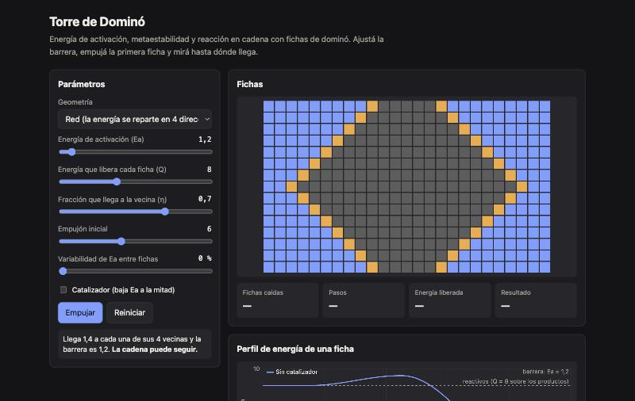

<div align="center">

# Chain Reaction

**Torre de Dominó.** Energía de activación, metaestabilidad y reacción en cadena, explicadas con fichas de dominó que caen (o no).

[**▶ Probala en vivo**](https://loiaconobruno.github.io/chain-reaction/) · [**📄 Paper y guía**](https://loiaconobruno.github.io/chain-reaction/guia.html) · [Cómo funciona](#cómo-funciona) · [Limitaciones](#limitaciones)

[](https://github.com/LoiaconoBruno/chain-reaction/actions/workflows/tests.yml)


[](LICENSE)



</div>

Página interactiva que usa fichas de dominó como metáfora de tres conceptos de química y física: **energía de activación** (el empujoncito que hace falta para que algo empiece), **metaestabilidad** (algo quieto pero no a salvo) y **reacción en cadena** (cada pieza que cae libera energía suficiente para tirar a la siguiente).

## Por qué

En el pizarrón esos conceptos son abstractos. Con fichas que caen (o no) según una barrera que podés mover, el umbral se ve en segundos. La página también muestra **dónde falla la metáfora**, para no reforzar el malentendido más común: que romper enlaces libera energía.

## Instalación

No hace falta instalar nada: **[abrila en el navegador](https://loiaconobruno.github.io/chain-reaction/)**.

Para usarla sin conexión o modificarla:

```bash
git clone https://github.com/LoiaconoBruno/chain-reaction.git
```

Después abrí `index.html` con doble clic. No hay dependencias ni paso de build. Para correr los tests hace falta Node 18 o más nuevo:

```bash
npm test
```

## Uso

Abrí la [demo en vivo](https://loiaconobruno.github.io/chain-reaction/) o `index.html` con doble clic.

Ejemplo:

1. Al abrir, la geometría es **Fila de dominó** con Ea = 5, Q = 8, η = 0,7 y empujón 6. La pista dice: "Llega 5,6 a la ficha siguiente y la barrera es 5. La cadena puede seguir."
2. Apretá **Empujar**: caen las 24 fichas. Resultado: **Cadena completa**, 24 pasos, energía liberada 192.
3. Subí **Ea** a 6 y apretá **Empujar**: cae solo la primera (**Se cortó**). Lo que le llega a la segunda (5,6) no alcanza su barrera.
4. Marcá **Catalizador**: la barrera baja a 3 y, al empujar, vuelve la **Cadena completa**. En el perfil de energía aparece la barrera original punteada.
5. Cambiá la geometría a **Red**: los parámetros vuelven a sus valores de base para ese modo (sin catalizador, barrera 1,2) y la energía de cada ficha se reparte en 4 direcciones: a cada vecina le llega 1,4. Al empujar, la reacción se expande desde el centro y caen las 375 fichas en 20 pasos.

## Cómo funciona

- Cada ficha tiene una barrera `Ea` (con una variabilidad opcional entre fichas, repetible gracias a una semilla).
- El empujón le da energía a la primera ficha (en la red, a la del centro). Cae si esa energía alcanza su barrera.
- Al caer libera `Q` y le pasa `η·Q` a la siguiente (fila) o `η·Q/4` a cada vecina (red). Las vecinas acumulan lo que les llega de varias fichas caídas.
- La simulación avanza por pasos: en cada paso caen todas las fichas que alcanzaron su barrera.
- El **perfil de energía** dibuja una ficha: reactivos a altura Q, barrera Ea por encima, productos en 0. Con catalizador, la barrera baja a la mitad.

La lógica está en `src/reaccion.js`, sin DOM, y se testea con:

```bash
npm test
```

## Limitaciones

- Es una metáfora, no una simulación química: no hay temperatura, difusión de calor ni cinética real.
- La regla de reparto de energía es una simplificación elegida para que el umbral se vea claro.
- No hay unidades: los números son relativos.

## Próximos pasos

- Modo "dominós crecientes": cada ficha 1,5 veces más grande que la anterior, como en el experimento de Lorne Whitehead (*American Journal of Physics*, 1983), para mostrar la amplificación.
- Armar el prototipo con fichas reales y probarlo con alguien que no sepa química.
- Agregar un recorrido guiado para clase: torre estable → empujón mínimo → cascada → historia de Sobrero (1847) y Nobel (dinamita, 1867).

## Paper de uso y guía

[`guia.html`](https://loiaconobruno.github.io/chain-reaction/guia.html) (fuente en [`docs/guia.md`](docs/guia.md)) tiene un paper de uso paso a paso y una guía de unas 20 páginas sobre la idea de fondo, con citas a los especialistas del tema.

## Licencia

MIT
